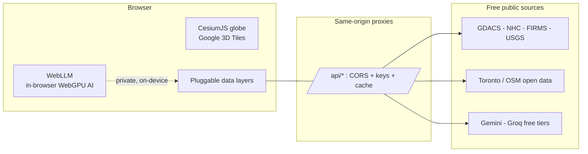

<div align="center">

# 🌐 Kosmoskopos

### An eye on every crisis.

A real-time humanitarian **crisis map**: a photorealistic 3D Earth that fuses live public data — global disaster alerts, hurricanes, wildfires, earthquakes, and hyperlocal heat-relief — into one situational-awareness command center you can **talk to**, powered entirely by **free and open** data and AI.

**Built for HackSocial 2026 · Social Good / AI-ML track**

</div>

---

## Why Kosmoskopos

When a disaster hits, the signals are already public — seismographs, storm trackers, fire satellites, city open-data — but they live in a dozen disconnected dashboards. Kosmoskopos turns those public signals into a **place**: one photorealistic globe where you can *see* every active crisis at once, ask an AI analyst what's happening, and zoom from the whole planet down to the nearest cooling centre. No classified data, no paid APIs — **open signal all the way down.**

## What it does

- **🚨 Live global disasters (GDACS)** — every active Orange/Red event worldwide: cyclones, earthquakes, floods, wildfires, droughts, volcanoes, updated continuously.
- **🌀 Live hurricanes (NOAA / NHC)** — every active tropical cyclone with real-time position and intensity.
- **🔥 Active wildfires (NASA FIRMS)** and **🌍 earthquakes (USGS)** — satellite fire detections and seismic activity.
- **❄️ Hyperlocal heat relief (Toronto)** — 585 air-conditioned public "cool spaces" from the city's Heat Relief Network, so the tool works at the scale of one vulnerable resident, not just the planet.
- **◈ Ask the planet — a free-AI "Duty Officer"** — ask a natural-language question about the live view and get a concise situation report, grounded in the on-screen data. Backed by a resilient free-AI chain (Gemini → Groq → a local model) that **never errors**, with a deterministic SITREP fallback when the free tiers are busy.
- **🔒 Private, in-browser AI** — one toggle runs a language model **100% in your own browser** via WebGPU (WebLLM). Private, zero server cost, works for any visitor — the AI runs on *your* device.
- **Photorealistic 3D globe** — Google Photorealistic 3D Tiles streamed through Cesium ion, with cinematic FLIR / night-vision / CRT visual modes.
- **Voice-free, keyless, free** — every data source is public and every AI provider is a free tier or runs locally. Nothing here can bill you.

## Tech stack

| | |
|---|---|
| **Globe** | CesiumJS · Google Photorealistic 3D Tiles via Cesium ion |
| **AI analyst** | Google Gemini (free) → Groq (free) → local model → rule-based SITREP; **WebLLM / WebGPU** for private in-browser inference |
| **Live data** | GDACS · NOAA NHC · NASA FIRMS · USGS · City of Toronto Open Data · OpenStreetMap (Nominatim geocoding) |
| **App** | Vanilla ES modules + Vite; same-origin Node proxies for CORS/keys; keys stay server-side |

## Architecture

Kosmoskopos is a **single Vite app with no separate backend** — every server responsibility (CORS shims, API-key custody, caching, rate-limiting) is handled by same-origin Node middleware that ships inside the Vite config, so the whole system builds to static assets plus a thin proxy layer.



**Pluggable layers.** Each live layer (disasters, hurricanes, heat relief, bike share, and more) is a self-contained factory implementing one lifecycle contract (`init / enable / disable / update / destroy`) over a Cesium `CustomDataSource`, registered in a single layer registry. Adding a data source is one file plus one registry entry.

**Resilient free-AI.** The "Duty Officer" analyst runs a fallback chain (Gemini, then Groq, then an optional local model, then a deterministic rule-based SITREP) so a rate-limited or offline provider degrades quietly instead of failing. A one-toggle **private mode** runs the model entirely in the visitor's browser via WebGPU (WebLLM), with zero server cost.

**Key custody and cost safety.** No API key ever reaches the browser; keys live only in the server-side proxies, every provider is a free tier or runs locally, and slow feeds (such as GDACS) are pre-warmed and cached server-side so no visitor waits on a cold upstream.

**Deploy.** `vite build` produces the static bundle; `vite preview` serves it together with the `/api` proxies on a single Render free-tier web service.

## Quick start

```bash
# Node 24 required
nvm use 24.14.0
npm install
cp .env.example .env    # add your free keys (Cesium ion, Gemini, Groq, NASA FIRMS)
npm run dev             # http://localhost:4173
```

The globe renders free with just a Cesium ion token. Every other layer degrades gracefully without its (free) key. See `.env.example` for the full list — all free-tier, no billing.

## Data sources & attribution

Kosmoskopos uses only public, openly-licensed data. In-app attribution is shown on the globe's credit line (Google / Cesium ion, required) and in the expandable **Data attribution** panel: GDACS (JRC / UN OCHA), NOAA National Hurricane Center (public domain), NASA FIRMS, USGS (public domain), City of Toronto Open Data, © OpenStreetMap contributors (ODbL), and others. Each provider retains its own terms.

## License

Code: [MIT](LICENSE). Third-party data and visual assets keep their own licenses (see the in-app attribution panel).

---

<div align="center">

**Kosmoskopos — every crisis, on one living globe.**

</div>
